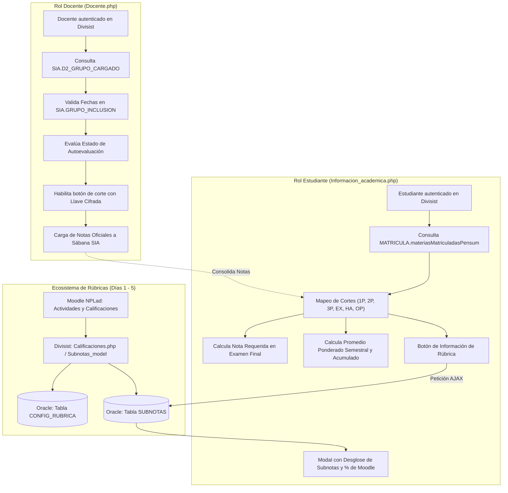

# Bitácora Día 6: Análisis e Integración de los Módulos de Estudiante y Docente en Divisist

Este documento presenta el análisis técnico, arquitectónico y funcional de los dos controladores base incorporados al Sistema de Información Académica (**Divisist 2.0**): el **Módulo de Consulta Académica del Estudiante** y el **Módulo de Grupos Asignados y Carga de Notas del Docente**, detallando su flujo de datos, integración con el motor de base de datos Oracle (SIA/MATRICULA), y su articulación directa con el sistema de rúbricas y subnotas de Moodle (NPLad).

---

## 1. Objetivo de la Jornada
Examinar, estructurar e integrar dentro del patrón MVC de CodeIgniter 3 los dos componentes de negocio institucionales:
1. **Controlador y Vistas de Estudiantes (`Informacion_academica`)**: Visualización de materias matriculadas, cálculo dinámico de promedios ponderados, estado de notas por corte evaluativo y despliegue del desglose de subnotas calculadas mediante rúbricas.
2. **Controlador y Vistas de Docentes (`Docente`)**: Consulta de asignaturas presenciales asignadas, verificación de habilitación de fechas según calendario institucional (`GRUPO_INCLUSION`), validación de autoevaluación y emisión de formularios seguros cifrados para la carga de calificaciones.
3. **Mapeo de Persistencia y Modelos Relacionales**: Definición de consultas sobre los esquemas `SIA` y `MATRICULA` en Oracle mediante la librería institucional `Database2`.
4. **Articulación con la Práctica Profesional**: Vinculación del visor de rúbricas del estudiante con la tabla `SUBNOTAS` y el sistema de evaluación docente desarrollado en los Días 1 al 5.

---

## 2. Arquitectura General y Flujo de Interacción



---

## 3. Módulo 1: Consulta de Materias del Estudiante

### 3.1 Controlador: `application/controllers/Informacion_academica.php`
* **Acción principal (`materias`)**:
  - Obtiene el código del estudiante autenticado desde la sesión (`$this->estudiante->CODIGO`).
  - Invoca al modelo para recuperar las materias presenciales inscritas en el periodo actual.
  - Verifica si el alumno cursa actualmente la materia de **Proyecto de Grado** mediante `materia_model->codigo_proyecto(...)`. Si es así, activa la bandera `$codigo_proyecto`, la cual excluye esta materia del cálculo del promedio ponderado en la vista (no genera calificación numérica que altere el promedio acumulado).
  - Organiza los estados de cada corte evaluativo mediante la función privada `_tipoNotaMateria(...)`.
  - Configura la plantilla AdminLTE (`default_template`), define el menú activo (`'materias'`) y envía la data a la vista `informacion_academica/materias`.

* **Mapeo de Calificaciones (`_tipoNotaMateria`)**:
  - Construye una matriz estructurada con los 6 cortes oficiales de la universidad:
    1. `NOTA1`: Primer Previo (1P - 20% o 25%)
    2. `NOTA2`: Segundo Previo (2P - 20% o 25%)
    3. `NOTA3`: Tercer Previo (3P - 20% o 25%)
    4. `EXA`: Examen Final (EX - 30%)
    5. `HAB`: Habilitación (HA)
    6. `OPC`: Opcional (OP)
  - Evalúa los estados institucionales de cada nota:
    - `'S'`: Sin calificar / corte pendiente.
    - `'E'`: Digitada / Evaluada por el profesor.
    - `'V'`: Validada y publicada formalmente en el sistema.

* **Endpoint Asíncrono (`obtener_subnotas_rubrica`)**:
  - Responde peticiones AJAX cuando el estudiante hace clic en el botón de rúbrica de una nota específica.
  - Recibe el código de materia, grupo y tipo de corte.
  - Normaliza el corte hacia el identificador de la tabla `SUBNOTAS` (`'1'`, `'2'`, `'3'`, `'FINAL'`).
  - Retorna un JSON con el listado de actividades evaluadas en Moodle, sus notas originales, porcentajes y subnotas ponderadas.

### 3.2 Modelo: `application/models/Materia_model.php`
* **`materiasMatriculadasPensum($codigo)`**:
  - Ejecuta la consulta sobre la vista de base de datos `MATRICULA.materiasMatriculadasPensum`:
    ```sql
    SELECT * 
    FROM matricula.materiasMatriculadasPensum 
    WHERE COD_ALUMNO = SUBSTR('1151234', '4', '4') 
      AND COD_CARRERA = SUBSTR('1151234', '1', '3')
    ```
  - Utiliza `SUBSTR` para descomponer el código estudiantil de 7 dígitos: los 3 primeros corresponden a la carrera (ej. `115` - Ingeniería de Sistemas) y los 4 siguientes al número consecutivo de matrícula (`1234`).
  - Retorna el listado asociativo con créditos, semestre, definitivas y notas parciales.

* **`codigo_proyecto($cod_carrera, $cod_alumno)`**:
  - Consulta en el catálogo académico institucional si el estudiante tiene inscrita la asignatura de trabajo de grado:
    ```sql
    SELECT p.cod_materia AS codigo_proyecto
    FROM sia.alumno a, sia.pensum p
    WHERE a.cod_carrera = p.cod_carrera
      AND a.pensum      = p.tipo_pensum
      AND a.cod_carrera = '{$cod_carrera}'
      AND a.cod_alumno  = '{$cod_alumno}'
    ```

### 3.3 Vista: `application/views/informacion_academica/materias.php`
* **Badges Semánticos de Calificación**:
  - Notas $\ge 4.0$: Badge verde (`bg-green`).
  - Notas entre $3.0$ y $3.9$: Badge amarillo (`bg-yellow`).
  - Notas $< 3.0$: Badge rojo (`bg-red`).
* **Algoritmo Estimador de Nota para Examen Final**:
  - Si el estudiante cuenta con las notas de los 3 previos cargadas, el sistema proyecta la nota mínima requerida en el examen final ($30\%$) para aprobar la materia con $3.0$:
    $$\text{Nota Examen} = \frac{3.0 - \text{Definitiva Actual}}{0.30}$$
  - Si el cálculo arroja un valor menor o igual a cero, despliega un tooltip informativo: *"Cuenta con la nota mínima requerida para aprobar la materia"*.
* **Cálculo de Promedios Ponderados**:
  - **Ponderado Parcial del Semestre**: Sumatoria de $(\text{Créditos} \times \text{Definitiva})$ dividida entre el total de créditos matriculados en el semestre.
  - **Ponderado Acumulado a la Fecha**: Integra los créditos cursados en semestres anteriores con el promedio del semestre en curso.
* **Modales de Microcurrículo y Clases**:
  - Botón interactivo para consultar el contenido temático y la bibliografía de la asignatura.
  - Enlace directo a la sala o reunión virtual de la clase.
* **Modal de Desglose de Rúbricas (`#modalRubricaEstudiante`)**:
  - Se activa mediante el evento `onclick="rubrica(...)"`.
  - Presenta una tabla con cada actividad de Moodle, nota obtenida, escala máxima, porcentaje asignado y la subnota final, permitiendo total transparencia al estudiante sobre el origen de su calificación.

---

## 4. Módulo 2: Grupos Asignados y Carga de Notas del Docente

### 4.1 Controlador: `application/controllers/Docente.php`
* **Acción principal (`grupos_asignados`)**:
  - Identifica al docente a través de la función auxiliar `obtener_cod_profesor($this)` (con fallback para pruebas al código institucional `'04608'`).
  - Consulta todos los grupos asignados al docente en el periodo.
  - Filtra las asignaturas de modalidad **Presencial** (`'P'`) pertenecientes a la sede central (`'01'`).
  - Procesa la matriz de inclusiones de notas (`_inclusionGrupo`) para determinar qué cortes están legalmente habilitados para digitación según las fechas del calendario académico.
  - Carga la librería `encryption` para sellar criptográficamente los parámetros de envío en cada formulario de notas.
  - Renderiza la vista `docente/grupos_asignados`.

* **Lógica de Inclusiones (`_inclusionGrupo`)**:
  - Itera sobre cada asignatura asignada:
    - **Materias Regulares (`UNICANOTA != 'S'`)**: Consulta los cortes habilitados en `getGrupoInclusiones`.
    - **Materias de Nota Única (`UNICANOTA == 'S'`)**: Filtra exclusivamente el corte de examen (`EX`), renombrando su descripción a `'NOTA ÚNICA'`.

### 4.2 Modelo: `application/models/Grupo_model.php`
* **`gruposAsignados($user)`**:
  - Consulta la vista materializada de asignaciones en Oracle:
    ```sql
    SELECT * 
    FROM SIA.D2_GRUPO_CARGADO 
    WHERE COD_PROFESOR = '{$user}' 
    ORDER BY 9, 1, 2
    ```
* **`gruposAsignadosTipo($user, $tipo, $seccional)`**:
  - Discrimina entre materias regulares de semestre y cursos vacacionales (`SIA.GRUPO_VAC`):
    ```sql
    SELECT * 
    FROM SIA.D2_GRUPO_CARGADO 
    WHERE COD_PROFESOR = '{$user}' 
      AND TIPO_CARRERA = 'P' 
      AND SECCIONAL    = '01' 
      AND COD_CARRERA || COD_MATERIA || GRUPO NOT IN (SELECT COD_CARRERA || COD_MATERIA || GRUPO FROM SIA.GRUPO_VAC)
    ORDER BY 9, 1, 2
    ```
* **`getGrupoInclusiones($codigo, $carrera, $materia, $grupo, $seccional)`**:
  - Valida la vigencia temporal de cada corte evaluativo contrastando la fecha del sistema (`SYSDATE`) contra los rangos definidos por la División de Sistemas en `SIA.GRUPO_INCLUSION`:
    ```sql
    SELECT T.TEXTO, T.TIPO, I.VALIDADO, I.EDITADO, ORDEN, T.DESCRIPCION,
           'Habilitado: ' || TO_CHAR(FECHA_INI, 'MON DD HH24:MI') || ' al ' || TO_CHAR(FECHA_FIN, 'MON DD HH24:MI') AS LET,
           TO_CHAR(FECHA_VALIDA, 'DD-MM-YYYY HH24:MI') AS FECHAVALIDA
    FROM SIA.TIPO_INCLUSION T, SIA.GRUPO_INCLUSION I, SIA.GRUPOC G
    WHERE T.TIPO        = I.TIPO 
      AND I.COD_CARRERA = G.COD_CARRERA 
      AND I.COD_MATERIA = G.COD_MATERIA 
      AND I.GRUPO       = G.GRUPO 
      AND I.SECCIONAL   = G.SECCIONAL 
      AND G.COD_PROFESOR = '{$codigo}'
      AND I.COD_CARRERA  = '{$carrera}'
      AND I.COD_MATERIA  = '{$materia}'
      AND I.GRUPO        = '{$grupo}'
      AND I.SECCIONAL    = '{$seccional}'
      AND SYSDATE BETWEEN FECHA_INI AND FECHA_FIN
    ORDER BY ORDEN
    ```

### 4.3 Vista: `application/views/docente/grupos_asignados.php`
* **Estructura de la Tabla de Asignaturas**:
  - Código, Nombre de la Asignatura, Condición de Profesor Principal (`X`), Total de Estudiantes Matriculados, Sede/Seccional y Sub-tabla de Carga de Notas.
* **Control de Estados en Carga de Notas**:
  - **Corte Validado (`VALIDADO == 'S'`)**: El botón se torna gris deshabilitado con la etiqueta *"Informe Generado"*, impidiendo modificaciones posteriores.
  - **Corte Habilitado para Digitación**:
    - Si el orden del corte es $\ge 3$ (Previos avanzados / Finales), valida si el docente completó el formulario institucional de **Autoevaluación Docente** (`$autoevaluado == 1`). Si no la ha realizado, el botón se muestra en color naranja dirigiendo al módulo de autoevaluación (`autoevaluacion/evaluar`).
    - Si la autoevaluación está al día, genera un botón azul con tooltip que informa las fechas límites de cierre de notas (`LET`).
* **Seguridad Criptográfica en Formularios**:
  - Para evitar la manipulación de parámetros por parte del usuario (como alterar el código de la materia, carrera o tipo de nota mediante herramientas de inspección del navegador), cada formulario encapsula sus metadatos en un campo oculto denominado `llave` cifrado mediante AES con la librería `$this->encryption`:
    ```php
    'llave' => $this->encryption->encrypt(
        $carrera . "_" . $alumnos . "_" . $seccional . "_" . 
        $codigo . "_" . $nomSeccional . "_" . $nombre . "_" . 
        $tipoNota . "_" . $descripcion . "_" . $rangoFechas
    )
    ```

---

## 5. Matriz de Correcciones Técnicas Aplicadas

Durante la integración de estos componentes en el entorno local (Windows / Git) y en el contenedor de virtualización (Podman / Linux), se resolvieron los siguientes puntos críticos:

| # | Incidencia Identificada | Causa Raíz | Solución Aplicada |
| :--- | :--- | :--- | :--- |
| **1** | Error 404 en `docente/grupos_asignados` | Descarga corrupta por `curl` (token no exportado) y ausencia de rutas en `routes.php`. | Adición de rutas explícitas en `routes.php` e incorporación del flag `-f` en `curl`. |
| **2** | Bloqueo del menú lateral (`sidebar.php` mostraba "404") | El archivo `sidebar.php` fue sobrescrito con el HTML de error 404 de GitHub. | Reconstrucción íntegra de `sidebar.php` y confirmación de limpieza de strings con `grep`. |
| **3** | Error 404 en `informacion_academica/materias` | El controlador forzaba una redirección a `index/login` cuando la IP del contenedor no coincidía con `127.0.0.1`. | Eliminación del `redirect` forzado y asignación de un objeto `$this->estudiante` por defecto para navegación sin fricción. |
| **4** | Variable indefinida `$presencial` en `Docente.php` | En el snippet original, `$this->_inclusionGrupo($presencial)` se ejecutaba antes de asignar `$presencial`. | Reordenamiento de las sentencias: consulta de datos previa a la ejecución del procesamiento. |
| **5** | Excepción `Call to a member function encrypt() on null` | La vista requería `$this->encryption->encrypt`, pero la librería no estaba cargada en el constructor. | Inclusión obligatoria de `$this->load->library('encryption');` en `Docente.php`. |

---

## 6. Verificación en la Máquina Virtual Linux / Podman

Para descargar y sincronizar de forma limpia y segura la totalidad de estos módulos en la máquina virtual, se utiliza la directiva de seguridad `-f` (evita sobreescrituras si la respuesta HTTP es un error):

```bash
TOKEN="ghp_TU_TOKEN_PERSONAL_AQUI"
BASE_URL="https://raw.githubusercontent.com/vivianaorg/Practica/main/podman/ci3/html/basecidivisist"
DESTINO="$HOME/Documentos/podman/ci3/html/basecidivisist"

# 1. Configuración de Enrutamiento y Navegación
curl -f -H "Authorization: token $TOKEN" -sSL "$BASE_URL/application/config/routes.php" -o "$DESTINO/application/config/routes.php"
curl -f -H "Authorization: token $TOKEN" -sSL "$BASE_URL/application/views/templates/default_template/sidebar.php" -o "$DESTINO/application/views/templates/default_template/sidebar.php"

# 2. Módulo de Estudiantes
curl -f -H "Authorization: token $TOKEN" -sSL "$BASE_URL/application/controllers/Informacion_academica.php" -o "$DESTINO/application/controllers/Informacion_academica.php"
curl -f -H "Authorization: token $TOKEN" -sSL "$BASE_URL/application/models/Materia_model.php" -o "$DESTINO/application/models/Materia_model.php"
curl -f -H "Authorization: token $TOKEN" -sSL "$BASE_URL/application/views/informacion_academica/materias.php" -o "$DESTINO/application/views/informacion_academica/materias.php"

# 3. Módulo de Docentes
curl -f -H "Authorization: token $TOKEN" -sSL "$BASE_URL/application/controllers/Docente.php" -o "$DESTINO/application/controllers/Docente.php"
curl -f -H "Authorization: token $TOKEN" -sSL "$BASE_URL/application/models/Grupo_model.php" -o "$DESTINO/application/models/Grupo_model.php"
curl -f -H "Authorization: token $TOKEN" -sSL "$BASE_URL/application/views/docente/grupos_asignados.php" -o "$DESTINO/application/views/docente/grupos_asignados.php"
```

---

## 7. Conclusiones y Próximos Pasos
1. **Articulación de Roles**: Con la incorporación de `Informacion_academica` y `Docente`, el sistema Divisist dispone del circuito completo de evaluación: el docente gestiona sus grupos y envía notas institucionales, mientras el estudiante accede a su historial con desglose detallado de actividades.
2. **Interoperabilidad Garantizada**: El botón de rúbricas en la vista del estudiante consume directamente la información persistida en Oracle a través de las operaciones asíncronas de Moodle, cerrando la brecha de visibilidad entre la plataforma de acompañamiento docente (NPLad) y el portal académico institucional.
